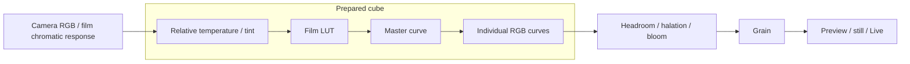

# JustShoot

SwiftUI film camera for iOS 26 and later. Build with Xcode 27 using the `JustShoot` scheme.

## Interaction priorities

Performance and fluid interaction take priority. Use visual previews and concise labels;
secondary explanations belong behind help controls. Permission guidance, recovery actions,
destructive confirmations and VoiceOver descriptions remain explicit.

Card covers share a filename-based cache across the home grid, camera picker and library.
Nearby sizes use 128/256/384/640/1024-pixel buckets, with a 50 MiB cache budget. Concurrent
consumers share one decode; cancelling a consumer releases it immediately and cancels queued
work when no consumers remain. Home and picker preparation use the existing two-worker image
queue concurrently. Cached covers appear before asynchronous display updates, including on
entry to card details. Catalog filter counts and buckets are built off MainActor once; only
selection changes filter the cards again.

Curve management displays larger response graphs and output strips. Loading screens use the
brand and a progress indicator, with status available to VoiceOver. Settings keeps shutter
guidance behind its info button and diagnostics collapsed until opened. These changes do not
establish a measured improvement in device frame rate, shutter latency or thermal behavior.

Camera LUT texture allocation and CPU upload run on a dedicated serial queue before a new
selection becomes available to preview or capture. The draw callback consumes an immutable
texture; the previous selection keeps rendering until the replacement is ready. The shared
texture cache retains at most 32 MiB / eight entries, and active renderers keep their own
references through eviction. Cancelled queued selections skip uploading. `preview_lut_uploaded`
records upload duration, and `camera_lut_prepare` now includes upload preparation.

Preview intermediate textures also allocate on a dedicated serial queue. A cold draw keeps the
last presented frame and retries on the next display tick instead of waiting for allocation on
MainActor. Each renderer allows one pending allocation and caches at most three completed
target sets. Resize revisions reject stale results, and target readiness is checked before
acquiring a drawable. `preview_targets_prepared` reports allocation time; `preview_flow` records
these skipped ticks as `targets`.

Each Live Photo transcode configures its LUT filter once and reuses it on that transcode's
serial video queue. Independent transcodes own independent mutable filters. Every output graph
captures its own input, and the filter releases its input after producing the graph. Pixel
regressions cover deferred rendering, separate LUTs and changing frames with the full effect
chain.

Shutter touch feedback is immediate, and `shutter_acknowledged` records acknowledgement before
storage checks. A progress indicator shows film preparation or native capture; an hourglass
indicates a full save queue. VoiceOver names each state. Safe admission, still checkpointing
and the real exposure flash timing remain enforced. The recent-photo badge observes only the
newest indexed photo for its film, loading the full browsing snapshot when opened. Queue counts
publish only when they change. Camera entry failures use a short state title and recovery
actions; permission guidance remains explicit.

## Capture architecture

- `CameraManager` owns capture session configuration, device controls and per-request capture delivery. Hardware configuration and teardown share a process-wide serial queue; generation checks discard starts superseded by navigation or background transitions. Preview buffer dimensions use AVFoundation's automatic negotiation; the app no longer forces the preview proxy. Metal drawable dimensions remain independently bounded.
- `CameraCaptureAdmission` owns the shutter from storage reservation through native still checkpointing. It freezes session/focal identity, user EV, flash and rotation, and disables hardware controls during that interval. Backgrounding cancels requests that have not exposed; generation/token checks prevent an old request from firing after resume.
- Live Photo support, session enablement and the saved on/off preference are separate. Enablement is reconciled after outputs/format configuration and checked again after commit, before starting the session. The toolbar control stays visible; unavailable capture capability does not silently delete the control or overwrite the user's preference. A requested Live Photo fails explicitly if capability is lost before capture. If native video delivery fails after a usable still arrives, the still is saved and a global notice reports the missing dynamic resource.
- `CapturePipeline` coordinates one processing worker across camera views. Before exposure it reserves queue capacity and disk headroom. `CaptureJournal` checkpoints the original still and frozen LUT/render recipe under Application Support/PendingCaptures before releasing the shutter. Native video delivery completes that job later; foreground retries leave still-in-flight captures alone. After a process restart, incomplete native captures recover their still and any usable movie.
- Processing is serial and uses utility priority. Backgrounding cancels the processing task and propagates a cooperative cancellation signal into still rendering while retaining the journal. A synchronous codec operation already executing can finish before cancellation is observed. Foregrounding or restarting resumes pending captures. `CaptureQueueState` owns reservation, active, retained and recovery-issue slots; committed deletion immediately releases the corresponding slots. Terminal results advance the recovery revision so older inventories cannot restore a completed slot or hide a deferred one. Successful cleanup refreshes the inventory and clears resolved attention issues.
- `CameraLensCaptureGate` waits for hardware acknowledgement, target zoom and an uninterrupted ZSL grace period. Timeouts and configuration failures reject capture until a new focal request; a later hardware callback cannot silently clear failure. iOS 27 telephoto locking gets a new grace period after switching the physical source. Capture admission also checks PhotoOutput readiness.
- `CameraCapturePolicy` uses one automatic ordinary-photo policy across configuration, prewarming and capture: `.balanced`, and the largest supported 4:3 dimensions in the nominal 24 MP class (including 24.5 MP sensor sizes). Formats that expose only 12/48 MP choose the ordinary 12 MP size; a format with no ordinary size keeps its smallest supported size. There is no output-quality selector, and old quality preferences do not affect new shots. Disabling Safe Shutter Limit restores the format exposure limit on the next camera setup/focal configuration. Processing stage exports receive the stable capture ID.
- The system preview underlay stays opaque while the upper Metal layer fades, avoiding brightness loss from double transparency. Live Photo pages expose retry for both still and dynamic resource failures, and use the dynamic resource dimensions independently of a placeholder image.
- Photos exports use stable capture filenames for retry lookup. SwiftData stores an idempotent index using the original capture timestamp. Both original and processed Live Photo files remain until export and indexing succeed.
- `PhotoLibrarySync` coalesces reconciliation across its entire async operation. Retained capture jobs are excluded from legacy-photo migration and orphan backfill. Storage initialization failures preserve the existing database and show a retry action.
- `FilmImagePipeline` builds the shared static/Live Core Image graph. All render paths use sRGB, and Live writer settings and output buffers explicitly declare matching color primaries, transfer function and conversion matrix. Preview and export apply LUT, highlight processing, Gaussian light diffusion and grain in the same order. Preview drawables are capped at a 1280-pixel long edge, with diffusion computed at half resolution; export keeps full-resolution processing. Final photos include metadata in a single encoding pass. New shots use automatic efficient HEIC compression instead of quality 1.0; pending legacy jobs retain their frozen encoding quality.
- LUT caches share a reusable byte-budget LRU (these limits cover cached data, excluding currently used capture bytes and in-flight GPU resources): raw/composed tables retain at most 64 MiB, color-adjusted tables 16 MiB and Metal textures 32 MiB. Evicted tables reload during background preparation; the Metal draw path consumes uploaded textures and never reads LUT files. Importing an unused LUT does not preload a second copy.
- `CaptureJournal` returns a recovery inventory that includes unreadable, unsupported and incomplete entries. Settings exposes their reasons, exact-copy original export and confirmed recovery-file deletion. Limited Photos access rejects deletion batches containing inaccessible assets, preserving their indexes.
- Startup waits for its storage, home snapshot, decoded covers and preview pipelines. Camera entry also awaits its real rendering context and current capture configuration. LUT loading remains demand-driven; synthetic Live Photo/HEVC warm-up is disabled. Postprocessing uses low-priority Core Image requests to leave GPU capacity for the viewfinder.

Automatic photo mode follows the public ordinary-camera defaults: balanced native processing, supported 24/12 MP capture, and efficient HEIC. Apple documents [balanced delivery](https://developer.apple.com/documentation/avfoundation/avcapturephotosettings/photoqualityprioritization) and the [ordinary 24 MP mode](https://support.apple.com/guide/iphone/change-advanced-camera-settings-iphb362b394e/ios); this app does not reproduce Camera's private scene/codec heuristics. HEIF uses quality 0.85 and JPEG fallback 0.9. The encoder varies byte allocation with content; there is no exact file-size cap, post-encode resize, or repeated quality search.

New film chromatic recipes protect LUT input after linear-light temperature gains. The shared Metal/Core Image implementation maps luminance and the largest channel through the same continuous soft shoulder, then scales chroma about the neutral axis. This keeps boosted highlights inside the LUT domain while retaining channel separation through half-float intermediates. Ordinary skin midtones and unit gains retain their previous response. The optional `highlightProtection` recipe field freezes this behavior; older pending captures without the field retain their original response and saved LUT bytes. Run diagnostics identify this version as `color_pipeline=protected_srgb_v4`.

Bundled Portra 400 and Pro 400H receive a gentler output-luma calibration before user curves: lower midtones open slightly and the steep middle response is reduced. A common chroma scale preserves RGB hue direction and keeps nodes in gamut. These two tables are prepared on a 33³ grid once during loading; other stocks retain their existing tone tables and imported LUTs retain their original bytes. Calibration remains provisional pending physical-device skin, backlight and mixed-light comparisons; native camera sharpening and tone mapping still contribute to the processed source.

New Portra 400 and Pro 400H captures use the frozen `balanced_v2` grain response. The fine-noise share decreases from 28% to 18%, overall amount decreases by 6%, and a smooth shadow weight reduces the deepest texture further. Positive and negative deviations use equal bounded amplitude, avoiding the former tendency to brighten dark regions and darken highlights. Pure black/white channels stay fixed. Preview, stills and Live frames share this implementation and deterministic seeds. Other stocks, imported LUTs and pending recipes without the optional grain `response` field retain the original algorithm; encoding diagnostics include `grain_response`.

Pro 400H also receives a localized dark-gray refinement after the first calibration: a quadratic lift of at most 0.0065 in display luma, with about 6% less contrast around 0.15. A smooth lower taper preserves the black endpoint; the adjustment reaches zero with zero slope at 0.30, leaving brighter LUT nodes untouched without a compensating contrast spike. It adds no spatial blur or capture-policy changes. This refinement follows the supplied backlit desk photographs; its appearance on skin and other lighting remains unverified.

A host macOS comparison at 5712×4284 (24.47 MP) used a synthetic photo with gradients/detail and this repository's grain math. HEIF10 quality 1.0 → 0.85 reduced the grained image from 34.01 MB to 6.25 MB (81.6%), and the clean image from 19.96 MB to 2.05 MB (89.7%). Both outputs stayed 10-bit at the same dimensions. Grained-image PSNR was 49.79 dB, with gradient/detail RMSE 0.002656/0.003686 in 0–1 RGB; compression remains lossy. These measurements are a codec comparison, not a promise of identical iPhone Camera files or a real-device performance measurement.

Drawable sizing coalesces same-aspect animation samples until 100 ms of quiet, while initial/resumed and changed-aspect layouts apply immediately. One pending timer follows the latest target; inactive/detached views cannot update a drawable. GPU completion returns targets to a locked pool (at most three per committed size) before releasing the in-flight permit, so resource reuse does not wait for MainActor diagnostics.

Physical-source changes rearm the capture grace even after zoom has settled. The native KVO callback updates a 150 ms barrier synchronously; hardware invocation rechecks it and PhotoOutput readiness. Restricted lens policy is only written when it actually changes, and releasing a supported per-device lock explicitly uses `.auto` first. `focal_tele_lock_decision` records why optional telephoto locking is skipped. `native_photo_metadata` logs original lens/focal/dimensions before processing rewrites EXIF; it excludes GPS. `photo_encoding` reports actual codec, quality, pixel count and input/output bytes.

The queue accepts at most 16 outstanding captures with a 1 GiB soft disk budget and conservative pre-exposure disk reservations. Accepted captures are persisted even if the soft budget changes during exposure. Filesystem failures are surfaced; original files are never intentionally discarded to satisfy a queue budget. Future journal formats must be migrated explicitly; unreadable jobs are retained and visible. Successful journal cleanup removes originals and full recipes; finished media cannot currently be reprocessed nondestructively with another film.

Saving reuses freshly rendered image bytes after committing its journal checkpoint; only a
recovered rendered job reads those bytes from disk. Album discovery runs off MainActor while
concurrent saves still share one album-creation task. `capture_rendered_read` identifies a
recovered-file read, and the run header reports `capture_pipeline=rendered_data_reuse_v1`.

Photo detail starts thumbnail and full-preview requests together, displays either as it arrives,
and cancels an unnecessary thumbnail when the preview is ready. Legacy/fallback photos check
memory and display-prepared disk caches before accessing SwiftData image bytes; neighbour
thumbnail warmup reads one fallback at a time. Photo and film-card decoding share the same
consumer-aware request implementation, with independent caches. Cancelling one view keeps
other consumers alive; cancelling the final consumer skips queued work. Grid prefetch has at
most 24 pending requests and cancels them on scroll cancellation, index/density changes and
teardown. Cell reuse cancels its outstanding load. Gallery uses icons for selection, a spinner
and count for active saves, and one short empty-state label. The queue observer is confined to
its small indicator. These changes require device measurements to establish burst throughput
or time to first visible photo.

Gallery cells cancel requests and drop their image when they leave the viewport, then
resume on redisplay even without reuse. Hidden gallery tabs and the covered grid suspend
prefetch and visible-cell work. Detail high-resolution demand is restricted to the current
page and its immediate neighbours; previews use native screen pixels rather than a 2556px
minimum. The legacy preview cache is configured for three entries / min(96 MiB, RAM/32), is
cleared when detail closes, and rejects late cache writes from the previous generation.
Scrubber thumbnails use 160px with a ±4 preheat window; PhotoKit preheat is stopped when
the window changes or detail closes. Live resources are released when their page is no
longer current. While recent photos cover the camera, Metal drawing pauses and resumes
on dismissal without rebuilding the capture session or interrupting accepted Live captures.
Loading uses a spinner, failure uses an accessible retry icon, and the Live badge is an icon.
These lifecycle and allocation bounds are regression-tested; device frame times and resident
memory still need measurement under rapid scrolling, paging and camera return.

## Entry preparation

The system launch screen and the in-app preparation screen share a black background, an aperture icon and the JustShoot name. The system screen bridges process launch; asynchronous preparation runs in the app, and completion determines when the destination appears. There is no fixed branding delay. This follows Apple's distinction between [launching](https://developer.apple.com/design/human-interface-guidelines/launching) and [loading content](https://developer.apple.com/design/human-interface-guidelines/loading).

Home preparation opens the existing store, reads a lightweight custom-filter snapshot, decodes the eight bundled covers, prepares preview pipelines and registers the Photos observer. Prepared images stay strongly held through the first home render. SwiftData Query updates continue to drive later imports, edits and deletions. Historical-photo reconciliation and pending-capture processing keep their background lifecycle; they are not prerequisites for showing the home catalog.

Camera preparation keeps the session and Metal view mounted behind an opaque screen. It waits for the current session, capture readiness, current LUT, rendering resources, native photo-template completion, current audio configuration and a successful GPU frame captured after initial device configuration. Normal filter and focal changes use their existing local gates without showing the full-screen entry screen again. A new session after backgrounding must prepare again; stale callbacks cannot reveal it.

Preparation has retryable error states. Camera errors also provide Back, and denied permission provides Open Settings. The home timeout is 20 seconds per foreground attempt; the camera timeout counts 12 seconds of active preparation, excluding permission sheets. Background suspension does not exhaust these timers. Native operations that cannot be interrupted may finish later, but their stale results cannot replace the current attempt. Startup never deletes the store to recover from an error.

Diagnostics include `app_startup_prepare`, `startup_photos_observer`, `camera_entry_state`, renderer preparation and existing session/LUT/GPU stages. The run header identifies this implementation with `camera_revision=2026-10-19-async-preview`, `startup_pipeline=prepared_entry_v1` and `live_pipeline=reused_lut_v1`. Simulator tests cover state ordering and error/cancellation behavior; physical-device runs are still required to measure camera entry latency and sustained preview performance.

## Tone curves

The built-in catalog has five distinct roles. Chinese display names use two characters consistently; descriptions state the actual tonal adjustment:

| Curve | Chinese name | Adjustment |
| --- | --- | --- |
| Original | 原调 | Keep the film LUT's original tones. |
| Soft | 柔和 | Inverse S: reduce midtone contrast while keeping black/white endpoints. |
| Contrast | 鲜明 | Increase midtone contrast with a controlled shadow toe. |
| Faded | 褪色 | Lift the black floor, dip shadows and raise highlights with an S-shaped middle. |
| X-Pro | 负冲 | Cross-processed look with cool shadows and warm highlights. |

Open Shadows, Fade and Warm Print are retired from the catalog. The old Film Soft was another contrast-increasing S; Soft now has the opposite role. Faded (previously labeled Matte S) replaces the former near-linear Matte with a lifted-black S response (black 0.075, shadow 0.32→0.22, middle 0.5→0.5, light 0.72→0.84, white 1). Its shallow toe raises the deepest blacks while its steeper middle keeps shadow/highlight separation. Older active Matte selections are preserved as custom curves, including selections already stored in the atomic payload. On upgrade, an active retired or changed preset is copied into My Curves with its original control points. Unselected retired entries are removed; existing custom curves and already journaled LUT bytes are preserved.



Curve adjustments work on the developed sRGB output, after the film LUT. Control points use the same natural cubic spline in the editor, graph and LUT composition, sampled at 256 positions. Individual RGB curves follow the master. The graph displays this additional adjustment; the viewfinder shows it together with the film, optics and grain. These are artistic print/grading controls, and Soft adjusts existing tones rather than recovering clipped capture detail. Adobe's [tone-curve documentation](https://helpx.adobe.com/lightroom-classic/desktop/process-and-develop-photos/image-tone-color.html) describes the same input/output and combined/individual-channel model; the five-preset selection is this app's design choice.

Custom curve tables are prepared once and reused by selection, graphs, gray samples and LUT composition. Effective identity curves return the original LUT bytes, preserving finite imported HDR values outside the curve's unit domain. Render cache keys include the custom UUID and channel-separated control-point fingerprint; names, visibility and dates do not change the rendered pixels. Curve data and selection share one payload, with a mirrored legacy preference for compatibility. Unsupported or unreadable payloads stay intact and make curve management read-only. `camera_lut_prepare`, `camera_lut_ready` and `shutter_tap` record the curve identity without logging its custom name.

Non-neutral compositions use at least a 33³ cube. A 2³ or 3³ identity import otherwise samples only the endpoints or midpoint, where Contrast and Soft are unchanged, and silently loses the requested curve. Low-dimensional sources are interpolated before curve baking; original source data stays intact, and the resulting roughly 562 KiB table remains inside the existing byte-budget caches. Higher-dimensional sources keep their resolution.

## Validation

The entry-preparation update was validated on October 15, 2026 with project `JustShoot.xcodeproj`, scheme `JustShoot` and iPhone 18 Pro (iOS 27.0 Simulator): Debug tests passed 319/320, with zero failures and one Photos-authorization integration test skipped. The 29 new tests cover startup resource gating, deduplication, cancellation, timeout and retry, initial custom-filter deletion, camera generations and device warmup, GPU completion ordering and prepared cover sizing. The exact staged source snapshot also passed a Release build with no Swift compilation warnings; Xcode emitted its existing AppIntents metadata-extraction warning. Simulator UI inspection confirmed the home catalog appears, and camera-unavailable errors support Retry and Back. The built app contains the compiled LaunchScreen storyboard and its Info.plist entry. These checks do not measure physical-device camera startup time or sustained preview smoothness.

The viewfinder supports tap-to-focus and vertical exposure adjustment even while the film picker is open. A horizontal swipe selects a film while that picker is open; a gesture's purpose is locked once its direction is clear. Viewfinder directions follow how the phone was held at gesture start, keeping film and exposure axes distinct in landscape. Camera navigation disables interactive dismissal and both native back-pan recognizers to prevent accidental exits; the explicit Back action remains available. Recognizer states are restored when leaving the camera so other pages retain their normal navigation.

The compact control along the bottom of the viewfinder keeps temperature and tint on one row with independent Auto buttons and numeric readouts. Manual temperature is 3000–8000 K in 100 K steps; manual tint is −30…+30 in steps of 1. Lower tint values move toward green, higher values toward magenta. Auto values come from read-only camera white-balance gains, sampled at most twice per second and rounded to 100 K / one tint unit. Invalid startup gains are rejected before conversion, and missing readings display a dash. Real automatic readings are not falsely clamped to the manual slider limits.

The camera remains on automatic white balance. A manual axis is corrected in software relative to the latest measured camera white point, while an automatic axis retains its camera value. Both axes and the reference are included in the immutable LUT recipe/cache key. Preview, still processing and Live Photo processing share the same LUT; no custom hardware white-balance setters are used. Table generation runs on a serial actor with a bounded cache, and the last ready table keeps rendering while a new one is prepared. The shutter waits for the selected table without changing brightness. Both Auto axes use the original table exactly, so readout changes alone do not rebuild the LUT. Each new camera view starts with both axes on Auto. Validate device readouts and final colors on physical hardware.

`JustShootTests` covers LUT validation, capture-journal recovery and backpressure, timestamp-preserving index updates, color-space behavior, photo metadata, and Live Photo frame/metadata integrity and cancellation.

The October 19 camera-navigation guard adds two UIKit/SwiftUI hosting regressions for disabling edge/content back pans, explicit popping, restoration on other pages and re-entry. XcodeBuildMCP validation with `JustShoot.xcodeproj` / `JustShoot`, Debug, iPhone 18 Pro / iOS 27.0 Simulator passes all 27 related navigation, adjustment-routing and entry-preparation tests with zero failures or skips and no compilation warnings.

The October 19, 2026 input-protection and portrait-tone changes add 11 regressions. XcodeBuildMCP validation with `JustShoot.xcodeproj` / `JustShoot`, Debug, iPhone 17 / iOS 26.4 Simulator passed all 90 selected related tests with no skips or new compilation warnings. Coverage includes actual Metal/Core Image pixel agreement, static/Live frame agreement, temperature-extreme gamut bounds, unclipped boosted highlight ramps, skin midtone preservation, legacy recipe decoding, portrait LUT hue direction, curve composition, metadata and Live encoding. A 1025-step neutral ramp measured peak local display-luma slopes over 25–75% input of 2.340 → 1.732 for Portra and 1.838 → 1.615 for 400H, comparing the original bundled tables with the new loaded tables; white-point differences stayed below 0.02. These synthetic measurements describe tonal behavior. The existing Core Image QoS warning in the stage-diagnostics export test remains; real-device appearance and camera/Live Photo capture still require physical testing.

The portrait-grain follow-up and compatibility review add 11 regressions and pass all 101 selected related tests on the same Debug / iPhone 17 / iOS 26.4 Simulator context, with zero failures or skips and no new compilation warnings. The final Release build also succeeds on the same destination. Coverage includes legacy grain output samples, the original near-unit chromatic-gain bypass for pending recipes, capture-journal recovery, saturated-channel bounds, black/white preservation, average skin-tone RGB, fine-texture reduction, static/Live agreement, and actual preview/export grain pixels after aligning their vertical coordinate conventions. On synthetic 4000×64 uniform sRGB patches at 0.04 and 0.08, grain luminance standard deviation decreased by about 30% and 27%; the old mean-brightness bias of about 0.0035 was removed within floating-point tolerances. These are algorithm measurements, not before/after measurements of the supplied HEIC photos. The 400H refinement retains frozen LUT anchors and hue direction while smoothly reducing dark-gray separation. The existing stage-diagnostics Core Image QoS warning remains. No additional physical-device photographs were requested or taken for this follow-up.

The October 15, 2026 tone-curve simplification adds 38 regressions for curve roles and continuity, identity/HDR preservation, low-dimensional LUT composition, RGB order, immutable capture snapshots, legacy-selection migration and unreadable-library protection. XcodeBuildMCP validation on iPhone 18 Pro / iOS 27.0 Simulator passed 286/287 Debug tests with zero failures and one Photos-authorization integration skip; Release built successfully without Swift compilation warnings. UI inspection verified five manager entries, five template options and the S-Curve editor. The existing full-suite Core Image QoS warning remains recorded below. Real-device image comparisons are still required for subjective grading and preview/export appearance.

The Matte S follow-up adds four regressions for a lifted black floor together with darker shadow midtones, brighter lights and a preserved white point, plus migration from both legacy and atomic old-Matte selections. Its natural spline is strictly increasing (continuous derivative 0.10165–1.76173); the low-end toe is shallow and the middle retains contrast. Full Debug validation passed 290/291 tests, zero failed and one Photos-authorization test skipped, on the same iPhone 18 Pro / iOS 27.0 Simulator. Release built successfully without Swift compilation warnings. The existing Core Image QoS diagnostic remains unchanged.

The October 14, 2026 refactor adds 40 regression tests for shutter admission and stale session tokens, Live downgrade reporting, queue capacity after deletion, recovery inventories and original export, historical row/capture aliases, limited-access deletion policy, cache byte budgets and reconstruction, render cancellation, and encoded Live color tags. XcodeBuildMCP validation with `JustShoot.xcodeproj` / `JustShoot`, iPhone 18 Pro (iOS 27.0 Simulator): Debug tests passed 212/213 with one Photos-authorization integration test skipped; Release build passed. Both configurations produced no Swift compilation warnings; Xcode emitted its existing AppIntents metadata-extraction warning because the app has no AppIntents dependency. Existing lens, journal, metadata and hosted UI tests remain included. Hosted UI tests wait for the foreground window scene before constructing test windows.

The automatic-photo follow-up was validated on October 15, 2026 with the same project/scheme and iPhone 18 Pro (iOS 27.0 Simulator): 248/249 tests passed, zero failed, and the Photos-authorization integration test was skipped; Release built successfully with no Swift compilation warnings. Two final queue regressions cover late inventories after successful or deferred completion. Each source batch was validated from its staged Git snapshot before committing. Simulator UI inspection confirmed the quality selector is removed. One full-suite Debug processing-diagnostics test reports an internal Core Image QoS warning (its isolated run passes without the warning); the production utility/low-priority render path is retained. There is no measured post-change device shutter latency or file size yet.

```bash
xcodebuild -project JustShoot.xcodeproj -scheme JustShoot \
  -destination 'platform=iOS Simulator,name=iPhone 18 Pro' test
```

Automated agents should run build and test workflows through XcodeBuildMCP. Camera hardware, flash, audio recording, Photos permissions, background/foreground transitions during real captures, and sustained thermal behavior still require device testing. Include a burst followed by lock/unlock, permission denial followed by retry, and preview/export comparisons under strong highlights.

For device performance regressions, capture `session_queue_wait`, `session_configuration_done`, `session_start_running`, `session_stop_release`, `preview_first_frame` and `preview_perf`. These separate camera ownership/startup delays from main-thread encoding and GPU frame time. Simulator tests do not establish real-camera latency.

## Performance diagnostics

Color controls keep temperature and tint side by side in two separate capsules, with each value, gradient track and independent Auto button on one horizontal line. Automatic readings move only the thumb's Core Animation layer over the existing 0.5-second sampling interval; they do not generate interpolated camera values or per-frame SwiftUI updates. Manual dragging takes over from the visible thumb position and keeps its motion continuous while values sent to the LUT remain quantized (100 K / 1 tint). Reduce Motion disables the interpolation. The readouts continue to show the measured Auto values, including readings outside the manual ranges.

Diagnostics are enabled in Debug and Release. Filter the Xcode console for `diag `; every event carries a process `run`, a camera/capture `id`, and monotonic timing. The logging subsystem follows the app bundle identifier, with category `diagnostics`. Set the scheme environment variable `JUSTSHOOT_DIAGNOSTICS=0` to disable the additional monitoring.

On a device, reproduce the issue and use **Settings → Diagnostics → Export Diagnostic Log** to share a `.txt` file. No debugger is required. Diagnostic events are also written on a utility queue to three rotating 2 MiB files in Caches; pending file writes are capped at 256 KiB. Export includes retained sessions in chronological order. `diagnostic_log_overflow` and the export header's `file_write_failures` disclose missing records; this is a bounded recent history, not an unlimited crash recorder. Caches can be purged by iOS, so export promptly after reproducing the issue. Exported copies in the temporary directory are limited to the three most recent files.

- `run_begin`: device model, iOS version, build configuration, memory footprint, thermal state and Low Power Mode. Schema 3 adds `camera_revision`, `color_pipeline` and `lut_max_hz` to distinguish implementations when the app's marketing/build versions are unchanged. Older runs in an export do not validate the current implementation.
- `camera_view_appear`, `device_discovery_*`, `session_*`, `main_*`, `camera_state`: permission wait, hardware queue wait, input/format/output configuration, start/stop, and the delay returning to the main actor.
- `preview_first_buffer`, `preview_first_submitted`, `preview_first_gpu_completed`, `preview_first_presented`: first-frame milestones. Actual presentation callbacks are available on device; the simulator explicitly reports their unavailability.
- `preview_perf`: approximately two-second CPU/GPU and submission-rate summaries. `preview_capture_drop` includes AVFoundation's reason and is rate-limited. A five-second `camera_heartbeat` reports frame age and resource use, including when no new frames arrive.
- `preview_rendering_changed`: synchronous pause/resume at application, scene and view attachment boundaries. An inactive or detached view must not request another drawable; acquiring one can block the main thread. A queued draw rechecks availability before touching Metal.
- `camera_lut_prepare_*`: preparations are limited to 30 starts/second, keeping only the latest pending SwiftUI task. `cadence_wait_ms` distinguishes the short pacing wait from LUT preparation time. Continuous dragging does not extend the deadline. The last prepared LUT keeps rendering new camera frames until the next result is ready.
- `focal_begin`, `focal_dequeued`, `focal_device_locked`, `focal_ramp_issued`, `focal_constituent_changed`, `focal_settled`: correlate one transition by camera ID and `focal_seq`. Include requested/actual zoom, queue/lock delays, active lens type, format, exposure, white balance and system pressure.
- `preview_output_policy` and `session_output_ready`: record the requested output policy and the actual `preview_auto`/`preview_proxy` decision. `focal_transition_plan` records the actual-position anchor when interrupting a ramp. The hardware queue discards superseded or closed-session focal requests and computes the new ramp rate from the device position. A same-position zoom assignment cancels the old ramp's acceleration before starting the new ramp; `cancelVideoZoomRamp()` alone would only ease it out.
- `preview_flow`: numeric counters are accumulated in memory and emitted every two seconds and at focal/lifecycle boundaries. `capture_gap_ms` measures callback arrival gaps; `pts_gap_ms` measures source timestamp gaps; `submit_gap_ms` and `present_gap_ms` measure rendering submission and actual device presentation gaps. `*_age_ms` exposes a stream that has stopped producing events. Gaps span reporting windows, so a window's largest gap can exceed its duration. Counts in a window need not match because work crosses window boundaries.
- `preview_flow` also includes skip reasons, maximum CPU/GPU/drawable acquisition time, captured-frame age at submission, GPU completion-to-main-actor recycle wait, presentation latency, texture allocations and buffer-size changes. `duplicate` means the display tick saw the same frame; it is not automatically a dropped camera frame. GPU completion is not proof of presentation. Simulator logs set `presentation_supported=false`. Late callbacks from another generation/focal request increment `stale_callbacks` instead of contaminating the current transition.
- `zoom_samples` contains up to 24 `milliseconds_since_window_start:zoom:ramping` observations (first 23 plus latest); `zoom_n` reports the full observation count. These are KVO observations, not a promise that every sensor step was observed. No pixel buffers are copied or retained for diagnostics.
- `main_queue_stall` / `main_queue_recovered`: main-queue response delays of at least 250 ms. Only one probe can be outstanding; ongoing reports are limited to once every two seconds. Monitoring pauses while inactive. `watchdog_gap` identifies process-wide scheduling/suspension/debugger gaps instead of labeling them as a main-thread stall.
- `shutter_*`, `capture_*`, `live_*`, `still_*`, `photos_*`: one capture ID follows reservation, native callbacks, journaling, queue wait, processing, Photos export, indexing and thumbnail delivery.
- `recent_photos_open_*`, `photo_detail_open`, `photo_detail_selection`, `photo_page_load_*`, `photo_asset_request_*`: follow a saved capture into the viewer. The recent-photo button reads a committed index snapshot on tap instead of requiring `@Query` to refresh first. Thumbnail hints include photo identity, and cancelled older loads cannot replace a newer hint. PhotoKit loads distinguish missing/inaccessible assets, errors, cancellation and empty results; page logs distinguish a full preview from a thumbnail-only fallback. Failed empty pages offer Retry. `run_begin.gallery_pipeline=bounded_pages_v4` also includes cancellable Live Photo/original-data requests and refreshes grid cells when an existing photo gains an asset identifier or Live Photo resources.
- `photo_delete_begin` / `photo_delete_end`: delimit a deletion transaction. Active captures cannot enter deletion; recovery cannot start a job protected by an open deletion transaction. Admission is published before the worker's drain queue can see a job. Failure to commit the index deletion rolls back its journal discard markers, preserving retryable originals.
- `live_photo_prepare_*`, `live_photo_state`, `live_photo_preference_changed`: distinguish native support, session enablement and user intent. `shutter_tap.requested_live` records intent; `session_output_ready.live_supported` and `.live` record native state, along with the final session preset. Always separate runs by `run`; exports can contain earlier test sessions.

Span durations include suspension between their begin/end events. For example, a `library_reconcile` span crossing hours in the background does not establish hours of active CPU work or a UI hang; correlate it with `app_inactive`/`app_active` and the preview/main-queue measurements.

For a useful device trace: clear the console, cold-launch the app, enter/exit the camera three times (wait about five seconds in each), switch focal lengths, take a normal photo and a Live Photo, then background/foreground once. Include the whole `diag` trace from `run_begin` and say which action felt slow and whether the debugger was attached. New diagnostic fields contain timings, IDs, counts and system states, not image content, GPS coordinates or user file paths.

For zoom flicker specifically, stay on one film/curve first. Wait five seconds after entry, switch through the available focal lengths with two seconds between taps, then switch back and forth quickly. Repeat after one still and one Live Photo capture, then export the log. Note the focal pair and approximate moment of the visible jump. Also try a launch from the Home Screen without Xcode attached to separate debugger effects. Real camera transition smoothness still requires a device; synthetic frames and simulator tests only validate instrumentation and software behavior.

A trace where zoom reaches its target and presentation continues does not prove that the image's field of view changed. It rules out rejected requests and a continuous render stall for that interval, but proxy output or image geometry still needs device comparison. A wide constituent at a telephoto focal selection can be the system's digital-crop fallback; that alone does not explain an unchanged field of view. The rollback from forced proxy buffers must be validated against the observed 100/200 mm regression on device.

### Flow audit (2026-10-05)

The source audit covers storage startup, permissions and lifecycle, preview/zoom/focus/color controls, capture admission, durable processing/recovery, gallery loading/deletion, LUT import/deletion, and sharing. New regression coverage includes grid reconfiguration without identity changes, delayed PhotoKit completion/cancellation, failed LUT deletion, deletion versus capture recovery, and isolated share directories. A successful build/test run does not establish device camera behavior.

The simulator cross-page test also reproduced cooperative-pool starvation: ten detached cover-loading tasks waited inside the HEIF decoder, while camera discovery had already returned but startup/LUT tasks could not resume. Covers, legacy photo thumbnails/previews, cover color extraction and share conversion now use a dedicated operation queue with at most two concurrent blocking jobs. Cancelled queued work is skipped and cancelled waiters are released immediately. Resource/heartbeat logs include `image_work_active` and `image_work_queued`. Regression tests cover the concurrency bound, cancellation behind a blocked decoder, and a real bundled HEIF cover. Repeating Library → Films → Camera after the fix completed the LUT preparation and displayed the simulator's camera-unavailable state. This does not replace a device performance comparison.

Device checks still required: rapid focal reversals and actual framing; flash/EV/automatic color readings; still and Live Photo capture with microphone allowed/denied; immediate gallery entry; deletion while a saved fallback is being retried; cancellation of the system delete confirmation; background/foreground during saving; restricted Photos/iCloud access; low storage; and delivery to a receiving share extension. Export the complete run with `camera_revision=2026-10-19-async-preview` after reproducing an issue.

### Performance review (2026-10-20)

Pre-commit review covered shared-request cancellation, cache invalidation, GPU resource ownership,
Live filter isolation, durable save checkpoints, grid redisplay and camera-review lifecycle.
Debug build/run and the full XCTest suite passed on iPhone SE (3rd generation), iOS 26.5:
382 passed, zero failed, one Photos-permission integration test skipped. An unsigned Release
build for generic iOS also passed. Both configurations treated Swift warnings as errors and
reported no warnings. No temporary gallery fixtures are included. Device frame times, peak
resident memory and hardware capture/Photos behavior remain subject to the device checks above.
