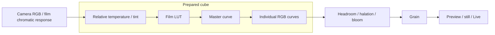

# JustShoot

SwiftUI film camera for iOS 17.0 and later. Build with Xcode 27 using the `JustShoot` scheme.

iOS 17 uses standard tab items, push navigation and material surfaces. Live Photo capture and
its sound controls are omitted on iOS 17; iOS 18+ retains them. Camera Control integration starts
on iOS 18 and Liquid Glass starts on iOS 26. Earlier systems estimate equivalent focal lengths
from lens field of view, display plain numeric labels, and preserve the camera's original focal
length EXIF. SDR capture and large imported LUTs remain supported. Standalone PQ/HLG photo
inputs require iOS 18's headroom mapping; iOS 17 retains unsupported source files for recovery.
Implementation and validation: [iOS 17 compatibility](research/ios17-compatibility/IMPLEMENTATION.txt).

New Portra 400 captures use a versioned Portra/Endura material pipeline: developed-sRGB input
adjustment → exposure diffusion → film layer-density LUT → density-domain grain → print/scan LUT
→ bounded portrait refinement → user curve and output headroom. Preview, stills and Live Photo
share its math and frozen parameters. Other looks and pre-material capture jobs use the
RGB-LUT pipeline. Pending schema-1 and schema-2 material jobs recover their own frozen tables,
color balance and calibration from the capture journal. The first phase uses Apple SDR RAW
development with a developed-SDR input domain. The migration plan and validation are in
[research/film-material-2026-10-29/PLAN.txt](research/film-material-2026-10-29/PLAN.txt).

The material performance follow-up preserves the accepted softer highlight/contrast treatment.
Exact identity input and finish tables use domain-clamping fast paths in both Metal and Core Image,
reducing default material color lookups from four to two. White-balance and curve variants reuse
the same immutable density/print preview textures through a bounded weak lookup pool; the existing
32 MiB/eight-recipe cache still charges each recipe conservatively. Runtime table tokens are not
serialized, and frozen recipe bytes and versions are unchanged. All 11 full-effect scene PNGs
are byte-identical to the pre-optimization material renders. This establishes output preservation
and reduced work, not measured device frame-rate, memory-footprint or thermal gains. Details are in
[research/film-material-2026-10-29/performance/REVIEW.txt](research/film-material-2026-10-29/performance/REVIEW.txt).

Capture admission checks immediate free space on a dedicated bounded queue, with reclaimable-space
fallback when needed. Ordinary capture stalls retain the last graded preview; the system preview
underlay is limited to lens transitions. Regression and supplied physical-device log results are in
[the capture stability review](research/film-material-2026-10-29/performance/capture-stability-review.txt).

The November 4, 2026 film catalog adds Gold 200, Ektar 100, Portra 800, Superia X-TRA 400,
Velvia 50, physical Provia 100F, Kodachrome 64, Tri-X 400, HP5 Plus 400 and T-Max 100.
The existing nine selections remain, including the separately named FUJIFILM camera simulations.
New stock colors retain their source LUTs without additional portrait/shadow refinement;
ISO-based grain remains automatic, with monochrome grain for the three new black-and-white stocks.
New LUTs are precompiled 33-point sRGB tables loaded on demand through the existing bounded caches.
Sources, redistribution licenses, reproduction commands and the 53-test simulator result are in
[the catalog integration review](research/mainstream-films-2026-11-04/REVIEW.txt).

The Film Vault lists 17 selectable looks, including the Fujifilm camera simulations displayed as
Velvia 50, ASTIA 100F, ACROS 100II and PROVIA 100F. Add a look from its detail page to use it
on the Films page and in the camera picker.
A new library starts with Portra 400, Gold 200, Pro 400H, C200, Ektar 100, Velvia 50, HP5 Plus 400,
Tri-X 400 and Classic Chrome. Saved Velvia 50 and Provia 100F selections carry over to the
corresponding camera simulations in their saved order. Previously captured photos retain their
original preset identifiers.
Removing a built-in look only removes it from the selection, so it can be added again.
Home and camera-picker covers prepare only the selected looks and load newly added covers on demand.
Release bundles exclude textual `.cube` sources and retain their compiled `.jslut` resources.
Debug bundles keep the sources for reference and hash tests. User `.cube` imports use the file-based loader.

## Lifetime membership

Open the crown in the upper-right corner of Settings to buy or restore lifetime membership.
The shared `JustShoot` scheme uses `JustShootProducts.storekit` when run from Xcode. Use
`MembershipStoreKitTests` to exercise local purchases, restores, approvals and refunds.

For sandbox and release, configure the non-consumable `leavestylecode.JustShoot.membership.lifetime`
for the app in App Store Connect. Set the storefront pricing, product localizations and review
information there. The local StoreKit price is for testing. Before submitting the first in-app
purchase with an app version, verify buying and restoring on a device through Sandbox or TestFlight.

## Interaction priorities

Performance and fluid interaction take priority. Use visual previews and concise labels;
secondary explanations belong behind help controls. Permission guidance, recovery actions,
destructive confirmations and VoiceOver descriptions remain explicit.

App pages use the standard Large text size, regular legibility weight and normal contrast in
both SwiftUI and UIKit. App-authored animations use their designed timing. When Reduce
Transparency flattens system materials, custom controls use translucent fills so the page
background remains visible. Selected wallpaper blur is rendered by Core Image. iOS controls
the appearance of system-owned surfaces, including the share sheet and permission prompts.

Card covers share a filename-based cache across the home grid, camera picker and library.
Nearby sizes use 128/256/384/640/1024-pixel buckets, with a 50 MiB cache budget. Concurrent
consumers share one decode; cancelling a consumer releases it immediately and cancels queued
work when no consumers remain. Home and picker preparation use the existing two-worker image
queue concurrently. Cached covers appear before asynchronous display updates, including on
entry to card details. Catalog filter counts and buckets are built off MainActor once; only
selection changes filter the cards again.

Curve management displays larger response graphs and output strips. Startup shows a progress
indicator with status available to VoiceOver. Settings keeps diagnostics collapsed until opened.
Safe shutter applies automatically. Live Photo records sound when microphone access is granted
and offers a link to system settings if access is denied.

Camera LUT texture allocation and CPU upload run on a dedicated serial queue before a new
selection becomes available to preview or capture. The draw callback consumes an immutable
texture; the previous selection keeps rendering until the replacement is ready. The shared
texture cache retains at most 32 MiB / eight entries, and active renderers keep their own
references through eviction. Cancelled queued selections skip uploading. `preview_lut_uploaded`
records upload duration, and `camera_lut_prepare` now includes upload preparation.

Preview intermediate textures also allocate on a dedicated serial queue. A cold draw keeps the
last presented frame and retries on the next display tick instead of waiting for allocation on
MainActor. Each renderer allows one pending allocation and caches at most three completed
target sets. Resize revisions reject stale results, and target readiness is checked before
acquiring a drawable. `preview_targets_prepared` reports allocation time; `preview_flow` records
these skipped ticks as `targets`.

Each Live Photo transcode configures its LUT filter once and reuses it on that transcode's
serial video queue. Independent transcodes own independent mutable filters. Every output graph
captures its own input, and the filter releases its input after producing the graph. Pixel
regressions cover deferred rendering, separate LUTs and changing frames with the full effect
chain.

Shutter touch feedback is immediate, and `shutter_acknowledged` records acknowledgement before
storage checks. The shutter turns gray while film preparation, native capture or a full save
queue prevents capture. VoiceOver names each state. Safe admission, still checkpointing
and the real exposure flash timing remain enforced. The recent-photo badge observes only the
newest indexed photo across films, loading the full browsing snapshot when opened. Queue counts
publish only when they change. Camera entry failures use a short state title and recovery
actions; permission guidance remains explicit.

## Source structure and ownership

The app remains a single target with filesystem-synchronized source groups. Folders express
ownership; they do not introduce packages, inheritance layers or additional runtime workers.

```text
JustShoot/
├── App/                         Entry, startup and navigation composition
├── Features/
│   ├── Camera/
│   │   ├── Presentation/        SwiftUI controls, selection and gestures
│   │   ├── Coordination/        Shutter flow and session-entry preparation
│   │   ├── Hardware/            AVFoundation, location and rolling capture
│   │   ├── Preview/             Renderer and bounded frame exchange
│   │   └── Policies/            Value types and capture/readiness decisions
│   ├── Films/                   Film home and LUT import UI
│   ├── Gallery/Detail/          Paging, zooming, scrubber and photo information
│   ├── FilmLibrary/
│   ├── Curves/
│   └── Settings/
├── Capture/                     Durable jobs, journal and recovery
├── Imaging/{LUT,Metal,Encoding,Metadata}/
├── Persistence/{SwiftData,Photos,CustomLUT}/
├── Shared/{ImageLoading,UI,Diagnostics}/
└── Resources/                   Bundled LUTs, film cards and catalog
```

App composition supplies feature dependencies. Camera presentation delegates shutter work to
`CameraCoordinator`, which uses narrow native-capture and processing contracts. Native hardware
stays in `CameraManager`; heavy processing stays in the application-wide `CapturePipeline` and
`Imaging`. Rendering consumes immutable recipe/source values rather than SwiftData models. Shared film
source/preset definitions, color adjustment values and crop geometry belong to `Imaging`, so the
image graph does not depend on camera controls or the film home.
Persistence owns model transactions and platform storage; Photos reconciliation and launch
cleanup have separate actors from the capture index writer. `PhotoDeletionService` is the shared
feature-level transaction joining Photos, the local index, recovery and image caches.

The camera view and coordinator share one manager. Entry tasks belong to that manager's current
session generation and are cancelled on stop; stale native/GPU/resource callbacks cannot reveal
a newer entry. Accepted capture callbacks retain the shutter coordinator until delivery to the
durable worker. Shutter release is keyed by capture identity, so an older Live Photo result cannot
unlock a newer exposure. `CameraPreviewFrameStore` retains only the latest native and presented
frames, without retaining UI objects. The process-wide hardware queue, single durable processing
worker, cache budgets and existing cancellation/checkpoint order remain authoritative.

`Photo` and `CustomLUT` keep their existing persisted fields and schema version. Model convenience
presentation, LUT file access and EXIF parsing live separately. Metal shaders and their quoted
headers stay together under `Imaging/Metal`; bundled resource names and paths remain stable.

## Capture architecture

- `CameraManager` owns capture session configuration, device controls and per-request capture delivery. Hardware configuration and teardown share a process-wide serial queue; generation checks discard starts superseded by navigation or background transitions. Both ordinary and Live modes request a normally zoomed video stream, bounded to a 1920-pixel long edge at the active format's exact aspect ratio. Metal drawable dimensions remain independently bounded.
- iPhone and iPad both use a portrait interface. Supported orientations agree in Debug/Release and in the app delegate. On iPad, `UIRequiresFullScreen` compatibility sizing is required for iPadOS 27 to honor that restriction; the `~iphone` override leaves iPhone windowing unchanged. Apple has deprecated this compatibility key, and Xcode reports a deprecation warning. The renderer still reads its attached scene so a system-imposed window orientation remains safe. The Metal view, native transition underlay, viewfinder aspect and tap-to-focus share that geometry. Motion sensing remains independent: controls and EV/film gestures follow physical holding, and still/Live capture orientation is frozen from the physical camera at shutter admission. A stale preview from a previous window orientation cannot authorize capture.
- `CameraCaptureAdmission` owns the shutter from storage reservation through native still checkpointing. It freezes session/focal identity, user EV, flash and rotation, and disables hardware controls during that interval. Backgrounding cancels requests that have not exposed; generation/token checks prevent an old request from firing after resume.
- Live Photo buffer availability/readiness and the saved on/off preference are separate. On iOS 18+, `LivePhotoRollingBuffer` hardware-encodes the same ordinary video samples used by the viewfinder at up to 30 fps; native still capture remains independent. Native photo-preview proxies are avoided because device captures reproduced focal-dependent proxy zoom errors. On supported systems the toolbar control stays visible while hardware readiness changes, preserving the user's preference. iOS 17 omits the feature and its controls entirely. A requested Live Photo fails explicitly if capability is lost before capture. If movie assembly fails after a usable still arrives, the still is saved and a global notice reports the missing dynamic resource.
- `CapturePipeline` coordinates one processing worker across camera views. Before exposure it reserves queue capacity and disk headroom. `CaptureJournal` checkpoints the original still and frozen LUT/render recipe under Application Support/PendingCaptures before releasing the shutter. Buffered movie delivery completes that job later; foreground retries leave still-in-flight captures alone. After a process restart, incomplete native captures recover their still and any usable movie.
- Heavy rendering is serial at utility priority. Deferred PhotoKit finalization and editing-input requests use a separate lane with at most two waits, so an older 24 MP request cannot block a ready photo. The editing-input request overlaps full-resolution rendering once the deferred original is verified. Backgrounding stops new renders and cancels waits for an unfinalized proxy. A deferred job with a started render or checkpointed film can finish its edit on the same asset. A started still render and ready Photos commits can finish during the finite background assertion. Expiration cancels remaining work and the journal retains its last durable stage. Foregrounding or restarting resumes pending captures. `CaptureQueueState` owns reservation, active, retained and recovery-issue slots; committed deletion immediately releases the corresponding slots. Terminal results advance the recovery revision so older inventories cannot restore a completed slot or hide a deferred one. Successful cleanup refreshes the inventory and clears resolved attention issues.
- `CameraLensCaptureGate` waits for hardware acknowledgement, target zoom and an uninterrupted ZSL grace period. Timeouts and configuration failures reject capture until a new focal request; a later hardware callback cannot silently clear failure. iOS 27 telephoto locking gets a new grace period after switching the physical source. Capture admission also checks PhotoOutput readiness.
- `CameraCapturePolicy` requests native `.quality` processing within the output's supported limit and selects the largest 4:3 still size available in the active format for the current mode. Live Photo uses direct delivery. For stills, 24 MP fusion uses an authorized PhotoKit proxy when it is the largest available size. The pipeline applies a reversible adjustment to the same asset after system processing. With direct delivery, the first Photos resource contains the finished film image. The toolbar exposes the Live Photo on/off control. Safe Shutter Limit is always active. Processing stage exports receive the stable capture ID.
- Exposure gestures and Camera Control use the device's recommended EV range bounded by hardware limits. Temporary point focus returns to continuous AF/AE without clearing user EV; an EV readout provides reset and VoiceOver adjustment. Touch requests coalesce, and capture waits for the latest native bias acknowledgement instead of an unconditional 200 ms delay. Flash metering and white balance remain under AVFoundation control. The existing Safe Shutter Limit policy is unchanged pending physical-device measurements.
- Journal storage accounting calibrates on startup/recovery, gallery deletion and errors, then updates only the changed capture directory. Repeated shutter admission checks use the cached total plus current volume headroom. At confirmed exposure the badge renders a preview bounded to 192 pixels using the frozen frame and recipe. Opening review requests up to 1024 pixels until the indexed photo is ready. Final rendering retains native dimensions. Completion thumbnails follow capture time, so a slow older job cannot replace the latest shot's badge.
- The system preview underlay stays opaque while the upper Metal layer fades, avoiding brightness loss from double transparency. Live Photo pages expose retry for both still and dynamic resource failures, and use the dynamic resource dimensions independently of a placeholder image.
- Photos exports use stable capture filenames for retry lookup. SwiftData stores an idempotent index using the original capture timestamp. Both original and processed Live Photo files remain until export and indexing succeed.
- `PhotoLibrarySync` coalesces reconciliation across its entire async operation. Retained capture jobs are excluded from legacy-photo migration and orphan backfill. Storage initialization failures preserve the existing database and show a retry action.
- `FilmImagePipeline` builds the shared static/Live Core Image graph. All render paths use sRGB, and Live writer settings and output buffers explicitly declare matching color primaries, transfer function and conversion matrix. Preview and export apply LUT, highlight processing, Gaussian light diffusion and grain in the same order. Preview drawables are capped at a 1280-pixel long edge, with diffusion computed at half resolution; export keeps full-resolution processing. Final photos include metadata in a single encoding pass. New shots use automatic efficient HEIC compression instead of quality 1.0; pending legacy jobs retain their frozen encoding quality.
- LUT caches share a reusable byte-budget LRU (these limits cover cached data, excluding currently used capture bytes and in-flight GPU resources): raw/composed tables retain at most 64 MiB, color-adjusted tables 16 MiB and Metal textures 32 MiB. Evicted tables reload during background preparation; the Metal draw path consumes uploaded textures and never reads LUT files. Importing an unused LUT does not preload a second copy.
- `CaptureJournal` returns a recovery inventory that includes unreadable, unsupported and incomplete entries. Settings exposes their reasons, exact-copy original export and confirmed recovery-file deletion. Limited Photos access rejects deletion batches containing inaccessible assets, preserving their indexes.
- Startup waits for its storage, home snapshot, decoded covers and preview pipelines. Camera entry also awaits its real rendering context and current capture configuration. LUT loading remains demand-driven; synthetic Live Photo/HEVC warm-up is disabled. Postprocessing uses low-priority Core Image requests to leave GPU capacity for the viewfinder.

AVFoundation can deliver smaller images than the requested maximum depending on the device, lens, and scene. New planned captures use HEIF quality 0.95 and JPEG fallback 0.97. The encoder allocates bytes according to image content and retains the delivered dimensions. See Apple's [maximum photo dimensions](https://developer.apple.com/documentation/avfoundation/avcapturephotosettings/maxphotodimensions) and [quality prioritization](https://developer.apple.com/documentation/avfoundation/avcapturephotosettings/photoqualityprioritization).

Gold 200, Portra 800 and Ektar 100 receive a bounded shadow-toe adjustment. New Portra 400 recipes use a broader grain at the same amplitude. FUJIFILM simulations always use fine grain in new captures and the viewfinder. The two grain bands use separate filters at preview sizes, and sampling approaches the full-size response smoothly near a 4000-pixel long edge. Texture fades smoothly in deep shadows and bright highlights. ACROS uses a smaller monochrome grain. The Live Photo still uses the grain seed of the video frame displayed at the still-image-time marker. Material validation, serialization and hashing run during look preparation. The journal stores the frozen tables and grain parameters. An active capture can reuse its verified material, while recovery reads and verifies the saved bytes.

New film chromatic recipes protect LUT input after linear-light temperature gains. The shared Metal/Core Image implementation maps luminance and the largest channel through the same continuous soft shoulder, then scales chroma about the neutral axis. This keeps boosted highlights inside the LUT domain while retaining channel separation through half-float intermediates. Ordinary skin midtones and unit gains retain their previous response. The optional `highlightProtection` recipe field freezes this behavior; older pending captures without the field retain their original response and saved LUT bytes. Run diagnostics identify this version as `color_pipeline=protected_srgb_v4`.

Bundled Portra 400 and Pro 400H receive a gentler output-luma calibration before user curves: lower midtones open slightly and the steep middle response is reduced. A common chroma scale preserves RGB hue direction and keeps nodes in gamut. These two tables are prepared on a 33³ grid once during loading; other stocks retain their existing tone tables and imported LUTs retain their original bytes. Calibration remains provisional pending physical-device skin, backlight and mixed-light comparisons; native camera sharpening and tone mapping still contribute to the processed source.

Legacy Portra 400 and Pro 400H recipes can retain the frozen `balanced_v2` grain response. The fine-noise share decreases from 28% to 18%, overall amount decreases by 6%, and a smooth shadow weight reduces the deepest texture further. Positive and negative deviations use equal bounded amplitude, avoiding the former tendency to brighten dark regions and darken highlights. Pure black/white channels stay fixed. Preview, stills and Live frames share this implementation and deterministic seeds. Recipes without the optional grain `response` field retain the original algorithm; encoding diagnostics include `grain_response`. Current Portra material captures use the density-domain algorithm described above, while current RGB captures use the area-matched grain recipe.

Pro 400H also receives a localized dark-gray refinement after the first calibration: a quadratic lift of at most 0.0065 in display luma, with about 6% less contrast around 0.15. A smooth lower taper preserves the black endpoint; the adjustment reaches zero with zero slope at 0.30, leaving brighter LUT nodes untouched without a compensating contrast spike. It adds no spatial blur or capture-policy changes. This refinement follows the supplied backlit desk photographs; its appearance on skin and other lighting remains unverified.

A host macOS comparison at 5712×4284 (24.47 MP) used a synthetic photo with gradients/detail and this repository's grain math. HEIF10 quality 1.0 → 0.85 reduced the grained image from 34.01 MB to 6.25 MB (81.6%), and the clean image from 19.96 MB to 2.05 MB (89.7%). Both outputs stayed 10-bit at the same dimensions. Grained-image PSNR was 49.79 dB, with gradient/detail RMSE 0.002656/0.003686 in 0–1 RGB; compression remains lossy. These measurements are a codec comparison, not a promise of identical iPhone Camera files or a real-device performance measurement.

Drawable sizing coalesces same-aspect animation samples until 100 ms of quiet, while initial/resumed and changed-aspect layouts apply immediately. One pending timer follows the latest target; inactive/detached views cannot update a drawable. GPU completion returns targets to a locked pool (at most three per committed size) before releasing the in-flight permit, so resource reuse does not wait for MainActor diagnostics.

Physical-source changes rearm the capture grace even after zoom has settled. The native KVO callback updates a 150 ms barrier synchronously; hardware invocation rechecks it and PhotoOutput readiness. Restricted lens policy is only written when it actually changes, and releasing a supported per-device lock explicitly uses `.auto` first. `focal_tele_lock_decision` records why optional telephoto locking is skipped. `native_photo_metadata` logs original lens/focal/dimensions before processing rewrites EXIF; it excludes GPS. `photo_encoding` reports actual codec, quality, pixel count and input/output bytes.

The queue accepts at most 16 outstanding captures with a 1 GiB soft disk budget and conservative pre-exposure disk reservations. Accepted captures are persisted even if the soft budget changes during exposure. Filesystem failures are surfaced; original files are never intentionally discarded to satisfy a queue budget. Future journal formats must be migrated explicitly; unreadable jobs are retained and visible. Successful journal cleanup removes originals and full recipes; finished media cannot currently be reprocessed nondestructively with another film.

Saving reuses freshly rendered image bytes after committing its journal checkpoint; only a
recovered rendered job reads those bytes from disk. Album discovery runs off MainActor while
concurrent saves still share one album-creation task. `capture_rendered_read` identifies a
recovered-file read, and the run header reports `capture_pipeline=rendered_data_reuse_v1`.

Photo detail starts thumbnail and full-preview requests together, displays either as it arrives,
and cancels an unnecessary thumbnail when the preview is ready. Legacy/fallback photos check
memory and display-prepared disk caches before accessing SwiftData image bytes; neighbour
thumbnail warmup reads one fallback at a time. Photo and film-card decoding share the same
consumer-aware request implementation, with independent caches. Cancelling one view keeps
other consumers alive; cancelling the final consumer skips queued work. Grid prefetch has at
most 24 pending requests and cancels them on scroll cancellation, index/density changes and
teardown. Cell reuse cancels its outstanding load. Gallery uses icons for selection, a spinner
and count for active saves, and one short empty-state label. The queue observer is confined to
its small indicator. These changes require device measurements to establish burst throughput
or time to first visible photo.

Gallery cells cancel requests and drop their image when they leave the viewport, then
resume on redisplay even without reuse. Hidden gallery tabs and the covered grid suspend
prefetch and visible-cell work. Detail high-resolution demand is restricted to the current
page and its immediate neighbours; previews use native screen pixels rather than a 2556px
minimum. The legacy preview cache is configured for three entries / min(96 MiB, RAM/32), is
cleared when detail closes, and rejects late cache writes from the previous generation.
Scrubber thumbnails use 160px with a ±4 preheat window; PhotoKit preheat is stopped when
the window changes or detail closes. Live resources are released when their page is no
longer current. While recent photos cover the camera, Metal drawing pauses and resumes
on dismissal without rebuilding the capture session or interrupting accepted Live captures.
Loading uses a spinner, failure uses an accessible retry icon, and the Live badge is an icon.
These lifecycle and allocation bounds are regression-tested; device frame times and resident
memory still need measurement under rapid scrolling, paging and camera return.

## Entry preparation

The launch screen follows the system appearance. If the app has a different appearance selected, the backdrop and ring blend into that palette as the ring begins to draw. Once the ring closes and home is ready, six aperture blades briefly meet and rotate open onto the page. Home preparation runs alongside the animation and offers Retry if preparation fails.

Home preparation opens the existing store and reads a lightweight custom-filter snapshot. Visible film tiles load covers independently with the shared bounded image decoder. SwiftData Query updates continue to drive later imports, edits and deletions. After the reveal, pending-capture recovery, launch maintenance and renderer warmup start in the background. Photos authorization checks and observer registration use a dedicated worker queue. Opening the gallery or returning to the foreground still reconciles the local photo index.

Camera preparation keeps the session and Metal view mounted behind a plain black cover, without a loading symbol or Back button. VoiceOver still identifies camera preparation. It waits for the current session, capture readiness, current LUT, rendering resources, native photo-template completion, current audio configuration and a successful GPU frame captured after initial device configuration. It adds no fixed delay after the first frame; lens/ZSL settling and GPU completion still gate entry. Normal filter and focal changes use their existing local gates without showing the full-screen entry screen again. A new session after backgrounding must prepare again; stale callbacks cannot reveal it.

Once home appears, the shared still-render CIContext warms on a worker without delaying home readiness. Camera entry joins that initialization if needed. The session manager owns entry resource preparation so SwiftUI navigation/toolbar rebuilds cannot cancel and restart the same attempt. Preview command queues, Core Video texture caches and the diffusion downsampler are also prepared off the main thread and reused across entries; exiting flushes unused cached frame textures while in-flight GPU leases remain valid. Initial focal metadata is read on the hardware queue and reused by the UI, with a refresh if session startup changes the active format. Hidden picker covers decode only after camera entry is revealed and cannot fail or delay camera readiness.

The first-interaction follow-up also warms the five still/Live Photo effect kernels from one shared Metal-library read. Preview Gaussian kernels are prepared on a serial worker and reused in a cache of at most 16 radius pairs. A single pending slot replaces superseded film/size requests; a cold miss retains the last complete frame rather than constructing kernels in the draw callback or displaying an incomplete effect. MPS encoding remains on MainActor, with no mutation after publication. Repeated selection of the current focal length preserves the existing ramp and ZSL grace; failed, stale or externally moved selections can still retry. Verbose capture-device diagnostics read hardware and format their output on the hardware queue, using the admitted capture's frozen focal length.

Preparation has retryable error states. Camera errors also provide Back, and denied permission provides Open Settings. The home timeout is 20 seconds per foreground attempt; the camera timeout counts 12 seconds of active preparation, excluding permission sheets. Background suspension does not exhaust these timers. Native operations that cannot be interrupted may finish later, but their stale results cannot replace the current attempt. Startup never deletes the store to recover from an error.

Diagnostics include `app_startup_prepare`, `startup_custom_filters`, `app_home_interactive`, `startup_photos_observer`, `camera_entry_state`, renderer preparation and existing session/LUT/GPU stages. The run header reports `startup_pipeline=home_first_v2`. Simulator tests cover state ordering and error/cancellation behavior. Measure launch and camera latency on physical devices.

## Tone curves

The built-in curves appear in the following default order.

| Curve | Chinese name | Adjustment |
| --- | --- | --- |
| Original | 原调 | Keep the film LUT's original tones. |
| Soft | 柔和 | Inverse S: reduce midtone contrast while keeping black/white endpoints. |
| Contrast | 鲜明 | Increase midtone contrast with a controlled shadow toe. |
| Faded | 褪色 | Lift blacks, soften highlights and reduce midtone contrast. |
| Faded S | 褪色 S | Keep the faded black and white points and add gentle midtone contrast. |
| X-Pro | 负冲 | Cross-processed look with cool shadows and warm highlights. |

The curve manager groups curves by camera visibility. Reordering acts on the visible list. Resetting the list restores default order and visibility while retaining custom curves. In the editor, tap the graph to add a point, drag to adjust it, or drag an interior point outside the graph to remove it.

Custom curve definitions, visibility and order sync through the user's private CloudKit database. Each device keeps its own camera selection. Before shipping the feature through TestFlight or the App Store, deploy the development record type `FilmCurveLibrary` with its `catalogV1` asset field to the production environment of `iCloud.leavestylecode.JustShoot`.

Open Shadows, Fade and Warm Print are retired from the catalog. The old Film Soft was another contrast-increasing S; Soft now has the opposite role. On upgrade, Faded S is inserted immediately after Faded in the saved order. Both can then be reordered and hidden independently. Older active Matte selections are preserved as custom curves, including selections already stored in the atomic payload. On upgrade, an active retired or changed preset is copied into My Curves with its original control points. Unselected retired entries are removed; existing custom curves and already journaled LUT bytes are preserved.



Curve adjustments work on the developed sRGB output, after the film LUT. Control points use the same natural cubic spline in the editor, graph and LUT composition, sampled at 256 positions. Individual RGB curves follow the master. The graph displays this additional adjustment; the viewfinder shows it together with the film, optics and grain. These are artistic print/grading controls, and Soft adjusts existing tones rather than recovering clipped capture detail. Adobe's [tone-curve documentation](https://helpx.adobe.com/lightroom-classic/desktop/process-and-develop-photos/image-tone-color.html) describes the same input/output and combined/individual-channel model; the five-preset selection is this app's design choice.

Custom curve tables are prepared once and reused by selection, graphs, gray samples and LUT composition. Effective identity curves return the original LUT bytes, preserving finite imported HDR values outside the curve's unit domain. Render cache keys include the custom UUID and channel-separated control-point fingerprint; names, visibility and dates do not change the rendered pixels. Curve data and selection share one payload, with a mirrored legacy preference for compatibility. Unsupported or unreadable payloads stay intact and make curve management read-only. `camera_lut_prepare`, `camera_lut_ready` and `shutter_tap` record the curve identity without logging its custom name.

Non-neutral compositions use at least a 33³ cube. A 2³ or 3³ identity import otherwise samples only the endpoints or midpoint, where Contrast and Soft are unchanged, and silently loses the requested curve. Low-dimensional sources are interpolated before curve baking; original source data stays intact, and the resulting roughly 562 KiB table remains inside the existing byte-budget caches. Higher-dimensional sources keep their resolution.

## Profile sync

The Settings profile syncs its nickname, motto and cropped avatar through the user's private CloudKit database. Local edits remain available offline and retry automatically. The app imports an existing local profile when the account has no cloud profile yet.

For signing, associate `iCloud.leavestylecode.JustShoot` with the `leavestylecode.JustShoot` App ID and refresh the provisioning profile. Save a profile in a development-signed build to initialize the `SettingsProfile` record type with its encrypted `profileData` field. Deploy the development schema to production in CloudKit Console before distributing a build that uses profile sync.

## Validation

The November 1, 2026 structure refactor used `JustShoot.xcodeproj` / `JustShoot` in Debug
with complete strict concurrency. Full simulator suites passed on iPhone 17 Pro / iOS 26.5
(546 passed, 14 skipped) and iPhone 15 Pro / iOS 17.5 (541 passed, 19 skipped), with zero
failures or compiler warnings. Seventeen added tests cover shutter admission, frozen delivery,
stale Live Photo callbacks, entry cancellation/resource failures, concurrent frame exchange and
deletion commit ordering. iPhone 17 Pro / iOS 26.5 and iPad Pro 11-inch (M5) / iOS 27 app
builds and entry inspection passed; camera-unavailable recovery and Back were checked on iPhone.
An isolated iOS 17.5 follow-up passed all 27 selected tests after giving the cold-cache image
test its own in-memory SwiftData container, removing its dependency on earlier startup tests.
Persisted fields, schema version, bundled resource paths and shader bytes are unchanged.
Physical camera, GPS, microphone, Photos/Live Photo integration and performance remain device checks.

The October 21, 2026 first-interaction follow-up passed a Debug build with no Swift compilation warnings and 395/396 tests on the iPhone SE (3rd generation), iOS 26.5 Simulator, using `JustShoot.xcodeproj` / `JustShoot`. Xcode emitted its existing AppIntents metadata-extraction warning; the Photos-authorization integration test remained skipped, with no test failures. Nine new regressions cover duplicate focal selection and retry, shared effect kernels, off-main diffusion preparation, obsolete queued films, bounded cache eviction, preparation failure recovery and actual Metal blur output matching the previous implementation. Simulator inspection verified camera-unavailable recovery, Retry and Back. Hardware lens switching, first-exposure latency and sustained preview timing still require physical-device measurements.

The October 21, 2026 camera-entry follow-up passed a Debug build with no Swift compilation warnings and 386/387 tests with `JustShoot.xcodeproj` / `JustShoot` on the iPhone SE (3rd generation) Simulator. Xcode emitted its existing AppIntents metadata-extraction warning. The Photos-authorization round-trip integration test was skipped; no tests failed. New regressions cover concurrent renderer-resource reuse, retained frame textures across an exit-time cache flush, cancellation and readiness without a fixed first-frame timer. Simulator inspection entered and exited two different films: each session started one resource-preparation attempt, and the shared renderer handles were created once with `main_thread=false`. Camera-unavailable recovery remained usable. These checks do not measure physical-device black-screen duration, exposure settling or capture latency.

The entry-preparation update was validated on October 15, 2026 with project `JustShoot.xcodeproj`, scheme `JustShoot` and iPhone 18 Pro (iOS 27.0 Simulator): Debug tests passed 319/320, with zero failures and one Photos-authorization integration test skipped. The 29 new tests cover startup resource gating, deduplication, cancellation, timeout and retry, initial custom-filter deletion, camera generations and device warmup, GPU completion ordering and prepared cover sizing. The exact staged source snapshot also passed a Release build with no Swift compilation warnings; Xcode emitted its existing AppIntents metadata-extraction warning. Simulator UI inspection confirmed the home catalog appears, and camera-unavailable errors support Retry and Back. The built app contains the compiled LaunchScreen storyboard and its Info.plist entry. These checks do not measure physical-device camera startup time or sustained preview smoothness.

The viewfinder supports tap-to-focus and vertical exposure adjustment even while the film picker is open. A horizontal swipe selects a film while that picker is open; a gesture's purpose is locked once its direction is clear. Viewfinder directions follow how the phone was held at gesture start, keeping film and exposure axes distinct in landscape. Camera navigation disables interactive dismissal and both native back-pan recognizers to prevent accidental exits; the explicit Back action remains available. Recognizer states are restored when leaving the camera so other pages retain their normal navigation.

The compact control along the bottom of the viewfinder keeps temperature and tint on one row with independent Auto buttons and numeric readouts. Manual temperature is 3000–8000 K in 100 K steps; manual tint is −30…+30 in steps of 1. Lower tint values move toward green, higher values toward magenta. Auto values come from read-only camera white-balance gains, sampled at most twice per second and rounded to 100 K / one tint unit. Invalid startup gains are rejected before conversion, and missing readings display a dash. Real automatic readings are not falsely clamped to the manual slider limits.

The camera remains on automatic white balance. A manual axis is corrected in software relative to the latest measured camera white point, while an automatic axis retains its camera value. Both axes and the reference are included in the immutable LUT recipe/cache key. Preview, still processing and Live Photo processing share the same LUT; no custom hardware white-balance setters are used. Table generation runs on a serial actor with a bounded cache, and the last ready table keeps rendering while a new one is prepared. The shutter waits for the selected table without changing brightness. Both Auto axes use the original table exactly, so readout changes alone do not rebuild the LUT. Each new camera view starts with both axes on Auto. Validate device readouts and final colors on physical hardware.

`JustShootTests` covers LUT validation, capture-journal recovery and backpressure, timestamp-preserving index updates, color-space behavior, photo metadata, and Live Photo frame/metadata integrity and cancellation.

The October 29, 2026 exposure and capture-flow refactor was validated with XcodeBuildMCP using `JustShoot.xcodeproj` / `JustShoot`, Debug, iPhone 17 Pro / iOS 26.4 Simulator. Coverage includes 458 distinct passing cases across the full run and focused reruns; physical-camera capture and the external Apple ProRAW fixture remain two conditional skips. Six hosted UI cases were initially blocked by the simulator's synthetic-photo deletion confirmation; after clearing it, all 20 related color-control, navigation and preview-lifecycle cases passed. The final storage/deletion/recovery/scheduling run passed all 12 cases. Quick-preview pixels, deterministic grain, native-dimension HEIC/Photos round trips, same-asset film adjustment and original preservation are covered. Normal and accessible-size EV controls were visually inspected. The final Release build and simulator launch passed with no Swift compilation warnings; the existing AppIntents metadata-extraction warning remains. No physical-device shutter, frame-rate or dark-scene performance measurement has been made for this change.

The October 19 camera-navigation guard adds two UIKit/SwiftUI hosting regressions for disabling edge/content back pans, explicit popping, restoration on other pages and re-entry. XcodeBuildMCP validation with `JustShoot.xcodeproj` / `JustShoot`, Debug, iPhone 18 Pro / iOS 27.0 Simulator passes all 27 related navigation, adjustment-routing and entry-preparation tests with zero failures or skips and no compilation warnings.

The October 19, 2026 input-protection and portrait-tone changes add 11 regressions. XcodeBuildMCP validation with `JustShoot.xcodeproj` / `JustShoot`, Debug, iPhone 17 / iOS 26.4 Simulator passed all 90 selected related tests with no skips or new compilation warnings. Coverage includes actual Metal/Core Image pixel agreement, static/Live frame agreement, temperature-extreme gamut bounds, unclipped boosted highlight ramps, skin midtone preservation, legacy recipe decoding, portrait LUT hue direction, curve composition, metadata and Live encoding. A 1025-step neutral ramp measured peak local display-luma slopes over 25–75% input of 2.340 → 1.732 for Portra and 1.838 → 1.615 for 400H, comparing the original bundled tables with the new loaded tables; white-point differences stayed below 0.02. These synthetic measurements describe tonal behavior. The existing Core Image QoS warning in the stage-diagnostics export test remains; real-device appearance and camera/Live Photo capture still require physical testing.

The portrait-grain follow-up and compatibility review add 11 regressions and pass all 101 selected related tests on the same Debug / iPhone 17 / iOS 26.4 Simulator context, with zero failures or skips and no new compilation warnings. The final Release build also succeeds on the same destination. Coverage includes legacy grain output samples, the original near-unit chromatic-gain bypass for pending recipes, capture-journal recovery, saturated-channel bounds, black/white preservation, average skin-tone RGB, fine-texture reduction, static/Live agreement, and actual preview/export grain pixels after aligning their vertical coordinate conventions. On synthetic 4000×64 uniform sRGB patches at 0.04 and 0.08, grain luminance standard deviation decreased by about 30% and 27%; the old mean-brightness bias of about 0.0035 was removed within floating-point tolerances. These are algorithm measurements, not before/after measurements of the supplied HEIC photos. The 400H refinement retains frozen LUT anchors and hue direction while smoothly reducing dark-gray separation. The existing stage-diagnostics Core Image QoS warning remains. No additional physical-device photographs were requested or taken for this follow-up.

The October 15, 2026 tone-curve simplification adds 38 regressions for curve roles and continuity, identity/HDR preservation, low-dimensional LUT composition, RGB order, immutable capture snapshots, legacy-selection migration and unreadable-library protection. XcodeBuildMCP validation on iPhone 18 Pro / iOS 27.0 Simulator passed 286/287 Debug tests with zero failures and one Photos-authorization integration skip; Release built successfully without Swift compilation warnings. UI inspection verified five manager entries, five template options and the S-Curve editor. The existing full-suite Core Image QoS warning remains recorded below. Real-device image comparisons are still required for subjective grading and preview/export appearance.

The Matte S follow-up adds four regressions for a lifted black floor together with darker shadow midtones, brighter lights and a preserved white point, plus migration from both legacy and atomic old-Matte selections. Its natural spline is strictly increasing (continuous derivative 0.10165–1.76173); the low-end toe is shallow and the middle retains contrast. Full Debug validation passed 290/291 tests, zero failed and one Photos-authorization test skipped, on the same iPhone 18 Pro / iOS 27.0 Simulator. Release built successfully without Swift compilation warnings. The existing Core Image QoS diagnostic remains unchanged.

The October 14, 2026 refactor adds 40 regression tests for shutter admission and stale session tokens, Live downgrade reporting, queue capacity after deletion, recovery inventories and original export, historical row/capture aliases, limited-access deletion policy, cache byte budgets and reconstruction, render cancellation, and encoded Live color tags. XcodeBuildMCP validation with `JustShoot.xcodeproj` / `JustShoot`, iPhone 18 Pro (iOS 27.0 Simulator): Debug tests passed 212/213 with one Photos-authorization integration test skipped; Release build passed. Both configurations produced no Swift compilation warnings; Xcode emitted its existing AppIntents metadata-extraction warning because the app has no AppIntents dependency. Existing lens, journal, metadata and hosted UI tests remain included. Hosted UI tests wait for the foreground window scene before constructing test windows.

The automatic-photo follow-up was validated on October 15, 2026 with the same project/scheme and iPhone 18 Pro (iOS 27.0 Simulator): 248/249 tests passed, zero failed, and the Photos-authorization integration test was skipped; Release built successfully with no Swift compilation warnings. Two final queue regressions cover late inventories after successful or deferred completion. Each source batch was validated from its staged Git snapshot before committing. Simulator UI inspection confirmed the quality selector is removed. One full-suite Debug processing-diagnostics test reports an internal Core Image QoS warning (its isolated run passes without the warning); the production utility/low-priority render path is retained. There is no measured post-change device shutter latency or file size yet.

```bash
xcodebuild -project JustShoot.xcodeproj -scheme JustShoot \
  -destination 'platform=iOS Simulator,name=iPhone 18 Pro' test
```

Automated agents should run build and test workflows through XcodeBuildMCP. Camera hardware, flash, audio recording, Photos permissions, background/foreground transitions during real captures, and sustained thermal behavior still require device testing. Include a burst followed by lock/unlock, permission denial followed by retry, and preview/export comparisons under strong highlights.

For device performance regressions, capture `session_queue_wait`, `session_configuration_done`, `session_start_running`, `session_stop_release`, `preview_first_frame` and `preview_perf`. These separate camera ownership/startup delays from main-thread encoding and GPU frame time. Simulator tests do not establish real-camera latency.

## Performance diagnostics

Color controls keep temperature and tint side by side in two separate capsules, with each value, gradient track and independent Auto button on one horizontal line. Automatic readings move only the thumb's Core Animation layer over the existing 0.5-second sampling interval; they do not generate interpolated camera values or per-frame SwiftUI updates. Manual dragging takes over from the visible thumb position and keeps its motion continuous while values sent to the LUT remain quantized (100 K / 1 tint). The readouts continue to show the measured Auto values, including readings outside the manual ranges.

Diagnostics are enabled in Debug and Release. Filter the Xcode console for `diag `; every event carries a process `run`, a camera/capture `id`, and monotonic timing. The logging subsystem follows the app bundle identifier, with category `diagnostics`. Set the scheme environment variable `JUSTSHOOT_DIAGNOSTICS=0` to disable the additional monitoring.

On a device, reproduce the issue and use **Settings → Diagnostics → Export Diagnostic Log** to share a `.txt` file. No debugger is required. Diagnostic events are also written on a utility queue to three rotating 2 MiB files in Caches; pending file writes are capped at 256 KiB. Export includes retained sessions in chronological order. `diagnostic_log_overflow` and the export header's `file_write_failures` disclose missing records; this is a bounded recent history, not an unlimited crash recorder. Caches can be purged by iOS, so export promptly after reproducing the issue. Exported copies in the temporary directory are limited to the three most recent files.

- `run_begin`: device model, iOS version, build configuration, memory footprint, thermal state and Low Power Mode. Schema 3 adds `camera_revision`, `color_pipeline` and `lut_max_hz` to distinguish implementations when the app's marketing/build versions are unchanged. Older runs in an export do not validate the current implementation.
- `camera_view_appear`, `device_discovery_*`, `session_*`, `main_*`, `camera_state`: permission wait, hardware queue wait, input/format/output configuration, start/stop, and the delay returning to the main actor.
- `preview_first_buffer`, `preview_first_submitted`, `preview_first_gpu_completed`, `preview_first_presented`: first-frame milestones. Actual presentation callbacks are available on device; the simulator explicitly reports their unavailability.
- `preview_perf`: approximately two-second CPU/GPU and submission-rate summaries. `preview_capture_drop` includes AVFoundation's reason and is rate-limited. A five-second `camera_heartbeat` reports frame age and resource use, including when no new frames arrive.
- `preview_rendering_changed`: synchronous pause/resume at application, scene and view attachment boundaries. An inactive or detached view must not request another drawable; acquiring one can block the main thread. A queued draw rechecks availability before touching Metal.
- `camera_lut_prepare_*`: preparations are limited to 30 starts/second, keeping only the latest pending SwiftUI task. `cadence_wait_ms` distinguishes the short pacing wait from LUT preparation time. Continuous dragging does not extend the deadline. The last prepared LUT keeps rendering new camera frames until the next result is ready.
- `focal_begin`, `focal_dequeued`, `focal_device_locked`, `focal_ramp_issued`, `focal_constituent_changed`, `focal_settled`: correlate one transition by camera ID and `focal_seq`. Include requested/actual zoom, queue/lock delays, active lens type, format, exposure, white balance and system pressure.
- `preview_output_policy` and `session_output_ready`: record the requested output policy and the actual `preview_auto`/`preview_proxy` decision. Revision `2026-10-30-live-compatible-framing` requests scaled video buffers for ordinary stills (long edge ≤1920, exact sensor aspect) with automatic preview sizing and the photo proxy disabled. Proxy-only zoom compensation is disabled for this stream. Live Photo uses automatic proxy negotiation: device graph probes rejected Live Photo with every ordinary-video size tested, including full resolution. Unsupported buffer aspects also retain automatic negotiation. Mode changes clear manual dimensions, invalidate the old frame revision and wait for new settled presentation before capture; switching back restores bounded video even when deferred delivery itself did not change. `focal_transition_plan` records the actual-position anchor when interrupting a ramp. The hardware queue discards superseded or closed-session focal requests and computes the new ramp rate from the device position. A same-position zoom assignment cancels the old ramp's acceleration before starting the new ramp; `cancelVideoZoomRamp()` alone would only ease it out.
- `preview_flow`: numeric counters are accumulated in memory and emitted every two seconds and at focal/lifecycle boundaries. `capture_gap_ms` measures callback arrival gaps; `pts_gap_ms` measures source timestamp gaps; `submit_gap_ms` and `present_gap_ms` measure rendering submission and actual device presentation gaps. `*_age_ms` exposes a stream that has stopped producing events. Gaps span reporting windows, so a window's largest gap can exceed its duration. Counts in a window need not match because work crosses window boundaries.
- `OutOfBuffers` identifies camera-pool pressure separately from late frames. Presentation callbacks transfer their source frame once, then clear the callback's ownership; GPU completion also clears its buffer/texture lease. The latest presented snapshot and an admitted shutter retain their frames as needed. Pool-limit regression tests verify reuse even while the callback lease remains alive; device logs are still needed to establish an actual drop-rate improvement.
- `preview_flow` also includes skip reasons, maximum CPU/GPU/drawable acquisition time, captured-frame age at submission, GPU completion-to-main-actor recycle wait, presentation latency, texture allocations and buffer-size changes. `duplicate` means the display tick saw the same frame; it is not automatically a dropped camera frame. GPU completion is not proof of presentation. Simulator logs set `presentation_supported=false`. Late callbacks from another generation/focal request increment `stale_callbacks` instead of contaminating the current transition.
- `zoom_samples` contains up to 24 `milliseconds_since_window_start:zoom:ramping` observations (first 23 plus latest); `zoom_n` reports the full observation count. These are KVO observations, not a promise that every sensor step was observed. No pixel buffers are copied or retained for diagnostics.
- `main_queue_stall` / `main_queue_recovered`: main-queue response delays of at least 250 ms. Only one probe can be outstanding; ongoing reports are limited to once every two seconds. Monitoring pauses while inactive. `watchdog_gap` identifies process-wide scheduling/suspension/debugger gaps instead of labeling them as a main-thread stall.
- `shutter_*`, `capture_*`, `live_*`, `still_*`, `photos_*`: one capture ID follows reservation, native callbacks, journaling, queue wait, processing, Photos export, indexing and thumbnail delivery.
- `capture_framing`: the presented frame's age, focal/source revisions, software crop, buffer/drawable dimensions, rotation and clean aperture at shutter admission. `native_photo_metadata` also covers the finalized deferred 24 MP source, before the film encoder replaces the requested focal-length tag; it includes the original equivalent focal length and digital zoom. A screenshot taken seconds before the photo cannot establish exact framing: use the retained shutter-time preview and finalized photo pair from the opt-in processing diagnostics on a stationary device. Builds and geometry tests do not establish sensor field-of-view parity.
- `exposure_bias_apply`, `exposure_bias_wait`: separate the newest EV request's native acknowledgement from AE convergence. `capture_device_snapshot` records exposure cap, target offset and maximum ISO; `native_photo_metadata` records encoded shutter time, ISO and EV. Compare these with preview-flow gaps and shutter timings on a physical device before changing the dark-scene shutter policy.
- `recent_photos_open_*`, `photo_detail_open`, `photo_detail_selection`, `photo_page_load_*`, `photo_asset_request_*`: follow a saved capture into the viewer. The recent-photo button reads a committed index snapshot on tap instead of requiring `@Query` to refresh first. Thumbnail hints include photo identity, and cancelled older loads cannot replace a newer hint. PhotoKit loads distinguish missing/inaccessible assets, errors, cancellation and empty results; page logs distinguish a full preview from a thumbnail-only fallback. Failed empty pages offer Retry. `run_begin.gallery_pipeline=bounded_pages_v4` also includes cancellable Live Photo/original-data requests and refreshes grid cells when an existing photo gains an asset identifier or Live Photo resources.
- `photo_delete_begin` / `photo_delete_end`: delimit a deletion transaction. Active captures cannot enter deletion; recovery cannot start a job protected by an open deletion transaction. Admission is published before the worker's drain queue can see a job. Failure to commit the index deletion rolls back its journal discard markers, preserving retryable originals.
- `live_photo_state`, `live_buffer_movie_ready` / `live_buffer_movie_failed`, `live_photo_preference_changed`: distinguish buffer readiness, resource delivery and user intent. State changes include encoded/dropped counts, maximum pending frames and encoder latency. `shutter_tap.requested_live` records intent; `session_output_ready.live_supported` and `.live` describe the unused native Live capability, not buffered capture availability. Always separate runs by `run`; exports can contain earlier test sessions.

Span durations include suspension between their begin/end events. For example, a `library_reconcile` span crossing hours in the background does not establish hours of active CPU work or a UI hang; correlate it with `app_inactive`/`app_active` and the preview/main-queue measurements.

For a useful device trace: clear the console, cold-launch the app, enter/exit the camera three times (wait about five seconds in each), switch focal lengths, take a normal photo and a Live Photo, then background/foreground once. Include the whole `diag` trace from `run_begin` and say which action felt slow and whether the debugger was attached. New diagnostic fields contain timings, IDs, counts and system states, not image content, GPS coordinates or user file paths.

For zoom flicker specifically, stay on one film/curve first. Wait five seconds after entry, switch through the available focal lengths with two seconds between taps, then switch back and forth quickly. Repeat after one still and one Live Photo capture, then export the log. Note the focal pair and approximate moment of the visible jump. Also try a launch from the Home Screen without Xcode attached to separate debugger effects. Real camera transition smoothness still requires a device; synthetic frames and simulator tests only validate instrumentation and software behavior.

A trace where zoom reaches its target and presentation continues does not prove that the image's field of view changed. It rules out rejected requests and a continuous render stall for that interval, but proxy output or image geometry still needs device comparison. A wide constituent at a telephoto focal selection can be the system's digital-crop fallback; that alone does not explain an unchanged field of view. The scaled-video path must be validated at every focal option, especially the observed 100/200 mm low-light regression, with paired shutter-time previews and photos on device. The opt-in `PhysicalCameraPipelineTests/testLivePhotoPreviewConfigurationSurvivesColdStartAndRoundTrips` (`JUSTSHOOT_VALIDATE_CAMERA_CONFIGURATION=1`) checks production cold starts and still/Live round trips on an already-authorized device without taking photos. Capability checks do not establish Live Photo framing parity or successful movie delivery: validate those separately using the opt-in capture test and paired images.

Earlier validation on 2026-10-30: 77 focused tests passed on the iPhone 17 simulator; production cold-start and still/Live configuration round trips passed on iPhone 17 Pro Max (iOS 27.2). The configuration test took no photographs. Ordinary-still framing was reported as largely aligned in device use; Live Photo edge alignment, movie delivery and buffer-drop improvement still need capture-level device validation.

Live framing follow-up (2026-10-30): rolling history is bounded to 4.5 seconds and 12 MiB of compressed video plus 2 MiB of PCM audio. At most two video buffers and four audio copies are admitted concurrently; up to four requested movies can assemble. Movie export starts on a preceding keyframe, includes up to 1.5 seconds after the native photo timestamp, preserves capture rotation, and feeds audio/video according to writer readiness to avoid interleaving deadlocks. The existing film processor supplies matching still/movie identifiers and timed still metadata. Closing or backgrounding seals available history for accepted captures, with an eight-second deadline; idle shutdown releases history immediately. No rolling disk files are written.

Capture-level evidence on iPad Pro 11-inch (3rd generation), iPadOS 27.2: all available 14/28/35/50 mm options generated native stills and movies. Offline edge correlation on stationary shutter-time pairs estimated 1.000–1.002 relative scale, with zero translation; video frames and focal round trips agreed at the same scale. This is an image-registration estimate, not pixel identity or a color-match claim. Processing both resources and loading them with `PHLivePhoto.request(withResourceFileURLs:)` succeeded without a Photos import, including microphone audio, overlapping captures and immediate camera closure. Cold starts and ordinary/Live mode round trips also passed. The final combined iPad run passed all nine selected tests with zero failures or skips. Hardware tests cover audio muxing, timing/rotation, cancellation and sealing for late still callbacks. The final iPhone 17 / iOS 26.4.1 simulator regression passed 83 tests with zero failures; three hardware-only tests were skipped on the simulator and passed on the iPad. A simulator build/run and visual inspection also completed. These checks write only temporary test resources/attachments. The earlier iPhone 17 Pro Max / iOS 27.2 35/50 mm smoke capture succeeded; full iPhone focal-range and low-light framing acceptance remains necessary, particularly 100/200 mm. No device performance improvement is claimed.

Earlier adaptive-window regression (2026-10-30, before the portrait-only product correction): on iPad Pro 11-inch (3rd generation), iPadOS 27.2, stable 35 mm captures across two device test runs covered portrait, upside-down and both landscape windows. Presented preview rotations agreed with the native camera's frozen 90°/270°/180°/0° capture angles, retained 3:4 or 4:3 output as appropriate, and produced playable Live pairs without importing assets into Photos. Visual inspection of the preview/native-still/shutter-time-video attachments found matching orientation and edges. The rotation test counts only poses held stable through capture. The updated simulator regression passed 44 orientation, framing, preview-lifecycle, adjustment and capture-admission tests on iPad Pro 11-inch (M5), iPadOS 27.0. Simulator inspection confirmed portrait/landscape camera-unavailable recovery layouts; actual camera evidence comes from the physical iPad. Split View/Stage Manager window resizing and iPhone physical rotation were not re-tested in this follow-up.

Portrait-only correction (2026-10-30): both device families now declare portrait only in Debug/Release and in the app delegate. On iPadOS 27, declarations alone reproduced a landscape scene; iPad compatibility sizing kept the scene portrait during simulator rotation through the four physical directions. The canonical `UIRequiresFullScreen` key is required to pass the device build's orientation validation; a `~iphone` false override preserves iPhone windowing behavior. This relies on Apple's deprecated compatibility mode and introduces one explicit Xcode deprecation warning ([Apple documentation](https://developer.apple.com/documentation/bundleresources/information-property-list/uirequiresfullscreen)). The final iPad Pro 11-inch (3rd generation) / iPadOS 27.2 run passed seven selected orientation and no-Photos Live capture tests, and the iPad Pro 11-inch (M5) / iPadOS 27.0 simulator passed 45 related regression tests, with zero test failures or skips. An additional six orientation-policy tests passed on iPhone 17 / iOS 26.4.1 and confirmed the iPhone compatibility override resolves to false. The fresh physical capture was portrait; the four-way motion/control mapping is covered by regression tests, but four-way physical capture was not repeated for this correction. The compatibility warning remains a separate repository validation exception, not a warning-free build claim.

For the no-Photos capture test, enable `JUSTSHOOT_VALIDATE_LIVE_FRAMING=1`; optional `JUSTSHOOT_FRAMING_AUDIO=1` validates authorized microphone audio and `JUSTSHOOT_FRAMING_CHECK_LIFECYCLE=1` adds overlapping/closing captures. `JUSTSHOOT_FRAMING_FOCALS=35,50` restricts a run to selected focal options. `JUSTSHOOT_FRAMING_WAIT_FOR_ROTATION=1` waits for four distinct physical iPad holding directions at the first selected focal; keep each direction for at least fifteen seconds. `JUSTSHOOT_FRAMING_ORIENTATIONS=3` can restrict that check to selected `UIDeviceOrientation` raw values. Only poses held stable through capture count. Every pose must keep the scene and preview portrait while controls and native capture follow physical holding. The test never overrides the user's system rotation lock. Keep the device stationary on a textured scene; attachments include the presented preview, native still and shutter-time movie frame.

### Flow audit (2026-10-05)

The source audit covers storage startup, permissions and lifecycle, preview/zoom/focus/color controls, capture admission, durable processing/recovery, gallery loading/deletion, LUT import/deletion, and sharing. New regression coverage includes grid reconfiguration without identity changes, delayed PhotoKit completion/cancellation, failed LUT deletion, deletion versus capture recovery, and isolated share directories. A successful build/test run does not establish device camera behavior.

The simulator cross-page test also reproduced cooperative-pool starvation: ten detached cover-loading tasks waited inside the HEIF decoder, while camera discovery had already returned but startup/LUT tasks could not resume. Covers, legacy photo thumbnails/previews, cover color extraction and share conversion now use a dedicated operation queue with at most two concurrent blocking jobs. Cancelled queued work is skipped and cancelled waiters are released immediately. Resource/heartbeat logs include `image_work_active` and `image_work_queued`. Regression tests cover the concurrency bound, cancellation behind a blocked decoder, and a real bundled HEIF cover. Repeating Library → Films → Camera after the fix completed the LUT preparation and displayed the simulator's camera-unavailable state. This does not replace a device performance comparison.

Device checks still required: rapid focal reversals and actual framing; flash/EV/automatic color readings; still and Live Photo capture with microphone allowed/denied; immediate gallery entry; deletion while a saved fallback is being retried; cancellation of the system delete confirmation; background/foreground during saving; restricted Photos/iCloud access; low storage; and delivery to a receiving share extension. Export the complete run with `camera_revision=2026-10-30-portrait-interface` after reproducing an issue.

### Performance review (2026-10-20)

Pre-commit review covered shared-request cancellation, cache invalidation, GPU resource ownership,
Live filter isolation, durable save checkpoints, grid redisplay and camera-review lifecycle.
Debug build/run and the full XCTest suite passed on iPhone SE (3rd generation), iOS 26.5:
382 passed, zero failed, one Photos-permission integration test skipped. An unsigned Release
build for generic iOS also passed. Both configurations treated Swift warnings as errors and
reported no warnings. No temporary gallery fixtures are included. Device frame times, peak
resident memory and hardware capture/Photos behavior remain subject to the device checks above.
